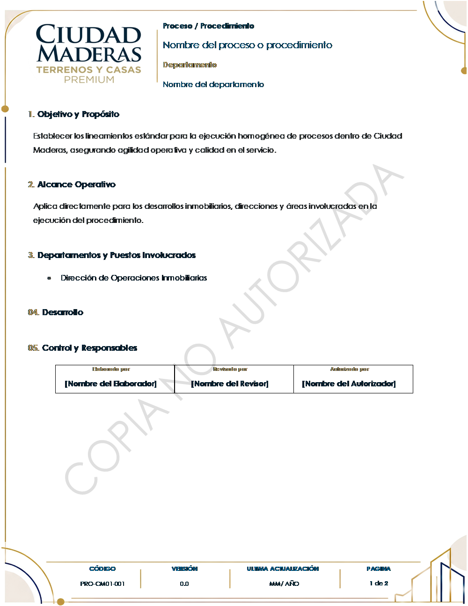

# Análisis inicial — Sistema de Documentación de Procesos

> **Estado:** validado con Gael y con las [respuestas de Procesos](#respuestas-de-procesos-13102026)
> del 13/10/2026. Lo pendiente está en [preguntas abiertas](#9-preguntas-abiertas).
> **Insumos analizados** (en `insumos/`):
> - `requerimientos-sistema.docx` → transcrito en [requerimientos.md](insumos/requerimientos.md)
> - `flujo-del-sistema.jpeg` → infografía del recorrido (12 pasos y 6 roles)
> - `plantilla-ciudad-maderas.docx` → plantilla institucional (vistas: `plantilla-vista-portada.png`,
>   `plantilla-vista-contenido.png`)
>
> - `respuestas-procesos.md` → respuestas del área de Procesos a las preguntas abiertas

## Decisiones tomadas

| # | Decisión | Fecha |
|---|---|---|
| 1 | **El documento de requerimientos manda** sobre la infografía y sobre lo que se platicó de palabra (precisado por la decisión 9). | 13/10/2026 |
| 2 | **Marca de agua:** todo lo generado antes del **Vo.Bo. final** sale con «COPIA NO AUTORIZADA». La validación de Procesos no la quita. Por la decisión 10, el Vo.Bo. final es el del director **en el sistema CH**: el documento limpio se genera cuando CH reporta «Autorizado». | 13/10/2026 |
| 3 | **Dos plantillas por tipo de documento:** preliminar (con marca) y final (sin marca). El final es un archivo nuevo; los preliminares no se tocan. | 13/10/2026 |
| 4 | **Drive:** todo vive en la carpeta del proyecto, con un ambiente de **pruebas** y uno de **producción** ([ambientes.md](ambientes.md)). | 13/10/2026 |
| 5 | **Propietario:** hoy `especialista2datos.ci`; en el futuro `procesos.ci`. Todo se diseñó para cambiarlo sin tocar código. | 13/10/2026 |
| 6 | **IA:** API de Gemini en su nivel gratuito, detrás de una capa intercambiable ([ia.md](ia.md)). | 13/10/2026 |
| 7 | **Repositorio en GitHub** y subida con clasp, como SIVET y Control Interno. | 13/10/2026 |
| 8 | **Base de datos:** 22 hojas definidas en `src/config/Esquema.gs` ([base-de-datos.md](base-de-datos.md)). | 13/10/2026 |
| 9 | **Las respuestas de Procesos precisan el requerimiento.** Donde lo contradicen, mandan las respuestas: vienen del mismo dueño del requerimiento y son más recientes. | 13/10/2026 |
| 10 | **Este sistema llega hasta el Vo.Bo. de Procesos.** Elaboración, IA, revisión y observaciones se hacen aquí; las autorizaciones formales del responsable y del director **se quedan en el sistema CH** y no se duplican. Sustituye al perfil «Autorizador» (§1) y a la autorización «dentro del sistema» (§4.4). | 13/10/2026 |
| 11 | **Código documental** `tipo-departamento+área-consecutivo` (ej. `P-CM01-001`). Prefijos: **M** Manual, **P** Procedimiento, **PRO** Protocolo, **PL** Política (además F Formato y DP Diagrama de proceso). Una actualización conserva el código. | 13/10/2026 |
| 12 | **Se construye primero el tipo Procedimiento.** Manual, Protocolo y Política entran cuando Procesos entregue y valide sus plantillas. *Reemplazada por la decisión 36.* | 13/10/2026 |
| 13 | **Plantilla v2 de Procedimiento:** mismo diseño, encabezado y pie reales (no cuadros de texto), y secciones de Responsabilidades (opcional), Definiciones (opcional) y **Control de cambios**. Procesos la valida antes de usarla ([plantillas.md](plantillas.md)). | 13/10/2026 |
| 14 | **«Autorizado por» muestra solo al autorizador final** (normalmente el director), con nombre, cargo y fecha que vienen de CH. | 13/10/2026 |
| 15 | **Sin conexión con el sistema CH.** Este sistema solo genera los archivos; Procesos los sube a CH. Cuando CH autoriza, **Procesos registra aquí** quién autorizó y cuándo, y con eso se genera el documento final sin marca (sustituye la pregunta A). | 13/10/2026 |
| 16 | **Gemini en su nivel gratuito, aprobado por Gael** (sustituye la validación de TI que pidió Procesos). Se mantiene el filtro de datos personales. | 13/10/2026 |
| 17 | **Letra Montserrat** en los documentos generados: en los PDF de Google, la «M» y la «W» de Century Gothic salen rotas ([plantillas.md](plantillas.md#plantilla-v2-de-procedimiento-13102026)). | 13/10/2026 |
| 18 | **Plantilla v2 de Procedimiento validada por Procesos** (Marco). Los documentos se generan en **Google Docs** (plan A): se llenan los 26 marcadores y se exporta a PDF y Word. Se descarta generar el Word desde su XML (plan B). | 13/10/2026 |
| 19 | **Perfiles sin superusuario** (§1: ser administrador no da facultades de revisar). Quien necesita más acceso recibe varios perfiles explícitos. Perfil nuevo **Soporte CI**: consulta todo (solicitudes, usuarios, catálogos, bitácora) y no cambia nada. Reglas: **nadie revisa su propia solicitud**; **nadie cambia sus propios perfiles ni se da de baja** (lo hace otro administrador); **siempre queda al menos un administrador activo**; todo cambio de usuarios y permisos queda en la **bitácora** con la persona real (aunque use «Ver como»). | 20/10/2026 |
| 20 | **Captura (fase 2):** las actualizaciones de documentos vigentes llegan en la fase 7 (necesitan el inventario); por ahora solo documentos nuevos. El responsable de cada actividad se puede escribir aparte (opcional) además de mencionarlo en el texto. Cada imagen se guarda en tres archivos: **WebP** para la app (§3.2: WebP preferente), **JPG** para el Word/PDF (Google Docs no acepta WebP) y una **miniatura**; el navegador los genera. Los nombres parecidos se avisan pero no bloquean: Procesos decide (§2.1). | 20/10/2026 |
| 21 | **Análisis y confirmación (fase 3):** antes de mandar a la IA se ocultan correos, CURP, RFC, cuentas, teléfonos y montos, y se restauran en la respuesta. Para **confirmar** hace falta: cada actividad con texto y **responsable**, objetivo, alcance y **todas las preguntas respondidas** (vale «No aplica» o «No lo sé»). Una propuesta sin decidir no bloquea (sin decisión, no entra). Si la actividad cambió después del análisis, su propuesta ya no se puede aceptar. Sin IA (apagada o sin cuota) todo se puede escribir a mano. | 20/10/2026 |
| 22 | **Documento preliminar (fase 4):** se genera **solo después de confirmar** y del contenido exacto confirmado (huella); después, Procesos también lo genera durante la revisión. Cada generación crea un PDF y un Word **nuevos** con «COPIA NO AUTORIZADA»; los anteriores se conservan y se marcan «de una versión anterior» si el contenido cambió. Documento nuevo: versión **0.0**, código «Por asignar» hasta el Vo.Bo., control de cambios con «Emisión inicial». El Google Doc intermedio va a la papelera de Drive: lo oficial son el PDF y el Word. La descarga pasa por el servidor, que revisa el permiso (§4.4). | 20/10/2026 |
| 23 | **Revisión de Procesos (fase 5):** **bandeja común**: cualquier revisor toma una solicitud sin asignar y queda como su revisor; el **administrador solo reasigna** (no revisa). Mientras Procesos defina otra forma (pregunta E), así queda; si la asignan por departamento, se ajusta. Observaciones por apartado o actividad: **por atender → atendida** (colaborador) **→ cerrada** (revisor). Devolver exige al menos una observación por atender; el **Vo.Bo.** exige que no haya ninguna y que el contenido sea el confirmado. El **código** lo propone el sistema (siguiente libre por tipo + departamento + área, pregunta F) y el revisor lo puede corregir; versión **0.0**. En cada envío y en el Vo.Bo. se guarda una foto del contenido (JSON). Ver [revision.md](revision.md). | 20/10/2026 |
| 24 | **CH y documento final (fase 6):** cualquier revisor registra la **subida a CH** (fecha y folio) y el **resultado**. **Autorizado:** nombre, puesto y fecha del autorizador final como vienen en CH; la solicitud queda `AUTORIZADO`, entra al **inventario** como vigente, se anota la **emisión inicial** en el historial de versiones y se genera el **final sin marca** desde la plantilla sin marca, con la fecha de CH. Un documento nuevo autorizado se queda en **versión 0.0** (respuesta 5). **Rechazado** (provisional, pregunta D): regresa al colaborador como observación con el motivo de CH, se borra el Vo.Bo. y, ya corregido, vuelve a pasar por Procesos con el **mismo código**. El final lo descargan quien ve la solicitud y el administrador (inventario). Ver [autorizacion-ch.md](autorizacion-ch.md). | 20/10/2026 |
| 25 | **Puestos y responsabilidades en una sola sección** (pedido de Procesos, 29/10): en pantalla y en el documento, «3. Puestos y responsabilidades»: cada puesto de las actividades con lo que le toca («Puesto: …»); la sección «Responsabilidades» de la plantilla se quita al llenarla y se renumera (sin cambiar la plantilla). | 29/10/2026 |
| 26 | **Procesos corrige el contenido** mientras revisa (pedido de Procesos, 29/10; §1 «revisar estructura y redacción»): el revisor asignado corrige objetivo, alcance, inicio, fin, responsabilidades, definiciones y el texto o responsable de una actividad. Cada corrección queda como **«Corregido por Procesos»** junto a esa parte (cómo estaba y cómo quedó), en la bitácora, y su huella se puede autorizar (HUELLA_REVISOR): el Vo.Bo. se da sobre lo corregido. Si después se la devuelven, el colaborador ve los cambios y vuelve a confirmar. **Confirmado por Gael** (29/10), con un **historial de cambios** por solicitud: correcciones de Procesos y propuestas de la IA aceptadas (antes y después) y cada paso del trámite, visible para el colaborador, Procesos y Soporte CI. | 29/10/2026 |
| 27 | **Avisos por correo** (fase 8, adelantada): a Procesos (Config → CORREO_PROCESOS y todos los revisores) cuando llega una solicitud; al colaborador cuando se la devuelven (con las observaciones), recibe el Vo.Bo., se autoriza o rechaza en CH o se cierra. En pruebas, el aviso de un usuario de prueba le llega a quien hizo la acción. Config → AVISOS_CORREO = NO los apaga. | 29/10/2026 |
| 28 | **Corregir el código después del Vo.Bo.** (mientras se encuentra el inventario anterior): Procesos cambia la numeración en la revisión o en Envíos a CH (mismo tipo, departamento y área; sin repetir). Si ya había documento generado, hay que volver a generarlo. | 29/10/2026 |
| 29 | **Confirmar y enviar en un paso:** «Sí, es correcto: enviar a Procesos» confirma y la envía; si quedan observaciones por atender, queda confirmada y dice qué falta. «No, necesito corregir algo» lleva directo al desarrollo; cada parte de la vista previa tiene un lápiz que lleva a corregirla. Al colaborador solo se le genera el **PDF** (el Word es para Procesos) y lo puede generar también mientras la revisan. | 29/10/2026 |
| 30 | **Tablero de indicadores** para el administrador (y Soporte CI, en consulta): procesos por etapa, tiempos promedio de revisión y de CH, porcentaje devuelto, los que más esperan, y por departamento, colaborador y revisor. procesos.ci@ciudadmaderas.com tendrá los perfiles de administrador **y** revisor (no hay superusuario: se le dan los dos). | 29/10/2026 |
| 31 | **Enlaces en las actividades:** cada actividad lleva los enlaces que necesite (páginas, carpetas de Drive, sistemas) con su descripción; solo direcciones web (http/https). Salen en la vista previa y en el documento como ligas. | 29/10/2026 |
| 32 | **Actualizaciones (fase 7):** se elige un documento vigente de los departamentos de la persona; se copia su contenido (si nació en el sistema) y se conserva el código; el sistema sugiere los motivos del control de cambios al comparar con la versión vigente y el colaborador los confirma y describe el cambio; Procesos elige **mayor o menor** en el Vo.Bo.; la versión vigente y el inventario no cambian hasta que CH autoriza. Una actualización a la vez por documento. Ver [actualizaciones.md](actualizaciones.md). | 29/10/2026 |
| 33 | **Importar un Word o PDF existente con IA** (propuesta de Procesos): la IA separa el documento en inicio, actividades con responsable y fin, sin inventar; el colaborador lo revisa antes de usarlo. El original se guarda en la carpeta de la solicitud. | 29/10/2026 |
| 34 | **Catálogo de puestos** en su propia pantalla: el administrador da de alta, corrige, da de baja o pega una lista; Soporte CI consulta. Los sinónimos ayudan a la IA. | 29/10/2026 |
| 35 | **«Todas las solicitudes»** para Soporte CI: la lista completa con filtro por estado y la solicitud en modo consulta. | 29/10/2026 |
| 36 | **Todos los tipos de documento usan la misma plantilla** (Gael, 30/10; reemplaza la decisión 12): Manual, Procedimiento, Protocolo, Política, Formato y Diagrama de proceso se pueden elegir y usan la plantilla de Procedimiento, cuyo texto del tipo es el marcador `{{TIPO_DOCUMENTO}}`; cada uno conserva su prefijo de código. Si un tipo llega a tener su plantilla, se usa la suya. | 30/10/2026 |
| 37 | **El inventario anterior no se considera por ahora** (Gael, 30/10): no se construye su carga. El inventario se forma con lo que se autorice en el sistema. Importar un Word o PDF sigue disponible en cualquier solicitud. | 30/10/2026 |

## Respuestas de Procesos (13/10/2026)

Marco (área de Procesos) respondió las 11 preguntas en la página del análisis. La transcripción
íntegra está en [respuestas-procesos.md](insumos/respuestas-procesos.md). Qué cambia:

| Tema | Lo que dijo Procesos | Qué cambia en el sistema |
|---|---|---|
| **Sistema CH** | Es una plataforma independiente de Capital Humano con un módulo de Procesos. Ahí se cargan los documentos, se avisa por correo y se dan los Vo.Bo. del responsable y del director. CH no autoriza contenido. No todos los procesos están en CH. | **Este sistema termina en el Vo.Bo. de Procesos** (decisión 10). No hay conexión con CH: Procesos sube los archivos y registra aquí el resultado (decisión 15). |
| **Autorizaciones** | Varían por tipo de documento, departamento y estructura, y las administra CH con sus reglas. El Vo.Bo. de Procesos no es la autorización oficial. | Sale del diseño la cadena de autorización interna (hoja `CadenasAutorizacion` y perfil `AUTORIZADOR`). Entran el estado «En autorización (CH)» y el registro del resultado que venga de CH. |
| **«Autorizado por»** | Solo el autorizador final, con nombre y cargo. La trazabilidad completa queda en CH. | El recuadro de la plantilla no cambia (decisión 14). |
| **Marca de agua** | (Se deriva de lo anterior.) | El PDF que se carga en CH para las firmas es el **preliminar con marca**. El archivo limpio se genera cuando CH reporta «Autorizado» (decisión 2). |
| **Código** | `XX-XY-YYY`: tipo, departamento + área (`CM01`) y consecutivo, elegidos de catálogos. El consecutivo debe evitar duplicados contra los documentos existentes. Una actualización conserva el código. Pendiente: si el consecutivo cuenta por tipo + departamento + área. | Se corrigen los prefijos sembrados (Procedimiento es **P**; `PRO` es Protocolo). Nuevo catálogo de **áreas** por departamento. |
| **Versiones** (propuesta por validar) | `0.0` desde la elaboración hasta la primera autorización. Mayores: 1.0, 2.0… Menores: 0.1, 1.1… El colaborador da motivo y descripción, y Procesos decide si es mayor o menor. La versión cambia solo al autorizarse. | Al dar el Vo.Bo., Procesos elige «mayor» o «menor» y el sistema calcula la versión propuesta. Se vuelve oficial cuando CH autoriza. |
| **Plantillas** | Cada tipo tiene su propia estructura, con criterios comunes (encabezado, nombre, código, versión, objetivo y alcance, responsables, control de cambios). Hoy solo existe la de Procedimiento. | Decisión 12. Al elegir el tipo, el sistema usa su plantilla. |
| **Secciones** | Responsabilidades (opcional), Definiciones (opcional), **Control de cambios** (obligatorio: versión, fecha, descripción y responsable). Fechas automáticas. Las fechas de autorización son las de CH. | Plantilla v2 (decisión 13). `HistorialCambios` necesita la columna del responsable de la modificación. |
| **Desarrollo** | Número automático, responsable (**puesto o departamento**), descripción, imágenes debajo con pie y tamaño uniforme. Procesos compartirá un documento aprobado de ejemplo. | Coincide con lo diseñado. El responsable puede ser también un departamento. |
| **Avisos** | Correo solo en cambios de estado relevantes: a Procesos al enviar y reenviar; al colaborador con observaciones y con el Vo.Bo.; a los dos con el resultado de CH. Incluye nombre, código, estado, responsable y liga. Recordatorios de pendientes. Sin duplicar los avisos de CH. | Módulo de avisos por estado y recordatorios. Cada documento necesita un **revisor de Procesos asignado**. |
| **IA** | De acuerdo con Gemini. Quieren una IA activa: también revisar secuencia, duplicados y estructura, y apoyar a Procesos en la revisión. Solo enviar actividades y puestos; nada de nombres, datos personales, contraseñas ni información financiera. Piden que **TI valide** el nivel gratuito. | Filtro que oculta correos, teléfonos, cuentas, RFC/CURP y montos antes de enviar a la IA. Apoyo de IA también en la bandeja de Procesos. Validación de TI pendiente. |
| **Inventario** | Existe (nombre, código, versión, departamento). La mayoría en Word, algunos en PDF. Proponen subir el documento existente y que la IA lo separe en actividades para que el colaborador las valide. | Importación con IA para las actualizaciones: Word directo y PDF con la lectura de texto de Google Drive. Se necesita el archivo del inventario. |

### Cambios en el esquema de la base de datos ✅ *14/10/2026*

Hechos al iniciar la fase 1 (detalle en [base-de-datos.md](base-de-datos.md#cambios-de-la-fase-1-14102026-por-las-respuestas-de-procesos)):

- `TiposDocumento`: prefijos M, P, PRO, PL, F y DP, con la columna `EN_SISTEMA` (solo Procedimiento
  por ahora; F y DP esperan la pregunta H).
- Nueva hoja `Areas` (departamento, nombre, clave) para armar el código.
- `Solicitudes`: área, revisor de Procesos asignado, descripción y tipo de cambio (mayor o menor).
- Se retiran `CadenasAutorizacion` y `Autorizaciones`; entra `EnviosCH` con lo que reporte CH.
- `HistorialCambios`: responsable de la modificación.

---

## 1. Resumen

Los colaboradores de Ciudad Maderas necesitan documentar cómo hacen su trabajo (manuales,
procedimientos, protocolos y políticas) y el área de **Procesos** necesita revisarlos, darles código,
versión y llevarlos hasta su autorización. Hoy eso se hace a mano en Word, con formatos y redacción
dispares, sin trazabilidad y sin control claro de qué versión es la vigente.

**La solución:** una web app en Google Apps Script donde el colaborador **describe su proceso
actividad por actividad** (con capturas de pantalla), una **IA le ayuda a redactarlo bien y le
pregunta lo que falta sin inventar nada**, el colaborador confirma el borrador, y el documento viaja
por **revisión de Procesos → autorizaciones → publicación**. El sistema genera el Word/PDF sobre la
plantilla institucional, con marca de agua «COPIA NO AUTORIZADA» hasta la autorización final, y
registra automáticamente quién elaboró, revisó y autorizó.

---

## 2. La problemática (lo que el sistema tiene que resolver)

| Problema de hoy | Cómo lo resuelve el sistema |
|---|---|
| El colaborador no sabe redactar un procedimiento ni qué secciones lleva | Captura guiada por actividades y preguntas orientadoras; la IA propone objetivo, alcance, responsabilidades y redacción |
| Los documentos llegan incompletos (sin responsable, sin excepciones, sin cierre) | La IA detecta lo que falta y pregunta; se puede responder «No aplica» / «No lo sé» |
| Cada documento tiene un formato distinto | Se genera siempre desde la plantilla institucional |
| Se duplican documentos que ya existen | Al crear uno nuevo se sugieren coincidencias del inventario documental |
| No se sabe quién revisó/autorizó ni cuándo | Elaboró / Revisó / Autorizó y fechas se registran solos, con foto del puesto en ese momento |
| Circulan borradores como si fueran oficiales | Todo lo previo a la autorización sale con «COPIA NO AUTORIZADA»; la versión limpia solo se descarga si el servidor lo permite |
| Se pierde el historial de versiones | Inventario documental con versión vigente, historial y control de cambios en actualizaciones |

---

## 3. El flujo como lo entendí

### 3.1 Recorrido (actualizado con las respuestas de Procesos)

```
 COLABORADOR                          PROCESOS (este sistema)              SISTEMA CH
 ───────────                          ───────────────────────              ──────────
 1 Inicio de sesión (perfil, nombre, puesto, depto. automáticos)
 2 Información general (tipo de solicitud, tipo de doc., nombre / doc. a actualizar)
 3 Desarrollo del proceso (inicio, actividades + imágenes, fin)
 4 Análisis con IA (redacción, responsables, objetivo, alcance, faltantes → preguntas)
 5 Vista previa y confirmación ◄──────────┐
 6 Envío a revisión ─────────────────►  7 ¿Requiere correcciones?
                                        │   Sí → observaciones ─┘ (vuelve al paso 5)
                                        │   No ↓
                                        8 Vo.Bo. de Procesos ─────────►  9 Carga en CH (PDF con marca)
                                          (código, versión propuesta)    10 Vo.Bo. del responsable
                                                                         11 Vo.Bo. del director
 13 Aviso del resultado ◄────────────── 12 Resultado de CH ◄─────────────┘
    Autorizado → documento final sin marca y versión vigente en el inventario
```

### 3.2 Estados de una solicitud (actualizados con las respuestas de Procesos)

| Estado | Quién la tiene | Sale hacia |
|---|---|---|
| `BORRADOR` | Colaborador | `CONFIRMADO` |
| `CONFIRMADO` | Colaborador (ya puede generar preliminar) | `EN_REVISION` · vuelve a `BORRADOR` si edita algo |
| `EN_REVISION` | Revisor de Procesos asignado | `DEVUELTO` · `EN_AUTORIZACION_CH` · `NO_PROCEDENTE` |
| `DEVUELTO` | Colaborador (corrige y atiende observaciones) | `CONFIRMADO` → `EN_REVISION` (regresa al mismo revisor) |
| `EN_AUTORIZACION_CH` | Sistema CH (responsable → director). Procesos registra aquí la subida y el resultado (decisiones 15 y 24) | `AUTORIZADO` · `DEVUELTO` si CH lo rechaza (provisional, pregunta D) |
| `AUTORIZADO` | — (documento final sin marca; pasa al inventario como vigente) | — |
| `NO_PROCEDENTE` | — (cerrada por Procesos con motivo, sin consumir código) | — |
| `CANCELADO` | — (el colaborador desiste de un borrador) | — |

Reglas que se derivan de los requerimientos:

- **Cualquier edición invalida la confirmación** (3.5). La confirmación se guarda ligada a una
  *huella* (hash) del contenido; si el contenido cambia, la huella ya no coincide y hay que volver a
  confirmar.
- **La versión vigente no se toca** mientras una actualización está en curso (2.1, 4.3).
- **Las devoluciones y correcciones no suben la versión oficial** (4.2); solo la autorización final.
- **No procedente no consume código** (2.1) → el código oficial se asigna lo más tarde posible
  (propuesta: al dar Vo.Bo. de Procesos).

---

## 4. Lo que encontré en la plantilla



- **Tamaño carta**, 2 páginas: **portada** (logo grande, «NOMBRE DEL PROCESO», «Código») y
  **contenido** (marco geométrico de fondo, logo, encabezado con tipo y departamento).
- Secciones del contenido: **1. Objetivo y Propósito · 2. Alcance Operativo · 3. Departamentos y
  Puestos Involucrados · 04. Desarrollo · 05. Control y Responsables** (tabla Elaborado / Revisado /
  Autorizado por).
- **Pie de página:** Código (`PRO-CM01-001`), Versión (`0.0`), Última actualización (`MM/AÑO`),
  Página (`1 de 2`).
- **La marca de agua «COPIA NO AUTORIZADA» ya está en el encabezado**, en las tres secciones.
  Confirmaste que es intencional: el documento que genera el colaborador sale con ella y la
  versión final se regenera sin ella.
- Los adornos (marco, portada) son **imágenes de página completa** detrás del texto; el texto de la
  portada y del encabezado vive en **cuadros de texto flotantes**.
- Fuentes: **Century Gothic** (cuerpo) y **Georgia**; vienen incrustadas en el archivo.

**Huecos de la plantilla frente a los requerimientos:**

| Lo pide el requerimiento | En la plantilla |
|---|---|
| Apartado de **Responsabilidades** (3.3) | No existe (solo «Departamentos y Puestos Involucrados») |
| **Definiciones** opcionales (3.3) | No existe |
| **Control de cambios / historial** en actualizaciones (4.2) | No existe |
| Fechas de elaboró / revisó / autorizó (4.1) | La tabla solo tiene nombres |
| Dos autorizaciones: responsable y Dirección (infografía) | Solo un recuadro «Autorizado por» |
| Plantilla por tipo: Manual, Procedimiento, Protocolo, Política (6) | Solo hay una («Proceso / Procedimiento») |
| Cómo se presenta cada actividad en «04. Desarrollo» (numeración, responsable, imágenes, pies) | Sección vacía, sin ejemplo |

Detalle menor: la numeración mezcla formatos («1.», «2.», «3.» y luego «04.», «05.»).

---

## 5. Discrepancias y vacíos que hay que cerrar

Ordenados por cuánto impactan el diseño.

1. ~~**¿Cuándo se quita la marca de agua?**~~ **Resuelto (decisión 2):** manda el requerimiento
   4.4; se quita solo con el Vo.Bo. final del jefe directo o director.
2. **El «sistema CH».** La infografía dice que, tras el Vo.Bo. de Procesos, el documento *pasa al
   sistema de Capital Humano*, que «gestiona el flujo de autorización». El requerimiento dice que la
   autorización ocurre *dentro del sistema*. ¿CH es otro sistema (por ejemplo, el módulo de Capital
   Humano de Control Interno) al que hay que mandar el documento, o es un rol dentro de este
   sistema? ¿CH aprueba algo o solo enruta? Esto decide si hay integración entre sistemas.
3. **Roles.** El requerimiento define 4 perfiles (Colaborador, Revisor de Procesos, Autorizador,
   Administrador); la infografía, 6 (Colaborador, Procesos, CH, Responsable, Dirección,
   Administrador). Propuesta: tratar *Responsable* y *Dirección* como **niveles** del perfil
   Autorizador, y *CH* según se resuelva el punto 2.
4. **Esquema de autorizaciones.** «Jefe directo o director facultado, *según el esquema
   correspondiente al documento*»: ¿la cadena es siempre responsable → Dirección, o depende del tipo
   de documento o del departamento? ¿Quién es el «responsable» de cada departamento?
5. **Código documental.** `PRO-CM01-001` parece *tipo – clave de área – consecutivo*. Falta la regla
   (prefijos por tipo, de dónde sale `CM01`, si el consecutivo es por tipo, por área o global).
6. **Versiones.** La plantilla trae `0.0`. ¿Un documento nuevo nace como 1.0? ¿Una actualización
   sube a 2.0 o a 1.1? ¿Depende del motivo del cambio?
7. **Plantillas por tipo y secciones faltantes** (ver tabla del punto 4).
8. **Inventario documental.** Para «actualización» y para detectar duplicados necesitamos el
   inventario de documentos existentes. Dijiste que el inventario de Procesos se trabajará después,
   pero **la base debe nacer preparada** para él. Además, los documentos actuales están en Word:
   no tienen «contenido estructurado» (actividades separadas), así que la primera actualización de
   cada uno requiere capturarlo o importarlo (la IA podría proponer la separación en actividades).
9. **Notificaciones.** Ningún insumo lo menciona, pero el flujo lo necesita (avisar a Procesos que
   llegó algo, al colaborador que se lo devolvieron, al autorizador que tiene pendiente).

---

## 6. Solución propuesta

### 6.1 Arquitectura

Misma base que SIVET y Control Interno: **todo dentro de Google Workspace**, sin servidores propios.

```
┌──────────────────────────────────────────────────────────────────┐
│ NAVEGADOR — SPA (HtmlService)                                    │
│  · captura por actividades, pegar con Ctrl+V                     │
│  · compresión de imágenes en el navegador (canvas → WebP/JPEG)   │
│  · vista previa del borrador y confirmación                      │
└───────────────────────────────┬──────────────────────────────────┘
                                │ google.script.run (una sola puerta: ClientApi)
┌───────────────────────────────▼──────────────────────────────────┐
│ APPS SCRIPT — reglas de negocio                                  │
│  Auth/perfiles · Solicitudes · Actividades · Imágenes · IA ·     │
│  Revisión · Autorizaciones · Generación de documentos · Bitácora │
└──────┬────────────────┬─────────────────┬────────────────┬───────┘
       ▼                ▼                 ▼                ▼
 Google Sheets     Google Drive      Google Docs       API de IA
 «BD Procesos»     imágenes,         plantillas →      (UrlFetchApp,
 (datos)           archivos, JSON    Word + PDF        llave en Script
                   de cada revisión                    Properties)
```

- **Acceso solo con la cuenta de Google corporativa** (sin usuario/contraseña propios): la app
  identifica al usuario por su correo y de ahí saca perfil, puesto y departamento.
- **La app corre como la cuenta que publica** (`executeAs: USER_DEPLOYING`, acceso al dominio): los
  usuarios no necesitan permiso sobre la hoja ni las carpetas, y **ningún archivo final es accesible
  directamente**; toda descarga pasa por el servidor, que revisa estado y permisos (requisito 4.4).
- **Un Apps Script ligado a cada hoja** (como SIVET), con los IDs de carpetas y plantillas en
  *Script Properties*: así hay **ambiente de pruebas y de producción** con el mismo código
  ([ambientes.md](ambientes.md)).

### 6.2 Generación del Word/PDF y la marca de agua

Recomendación: **dos plantillas en Google Docs por tipo de documento** — una *preliminar* con la
marca de agua y una *final* sin ella. Para generar:

1. Se copia la plantilla que corresponde (preliminar o final).
2. Se reemplazan los marcadores (`{{NOMBRE_DOCUMENTO}}`, `{{CODIGO}}`, `{{OBJETIVO}}`…).
3. Se insertan las actividades con sus responsables, imágenes y pies.
4. Se exporta a **PDF** y a **Word (.docx)** desde el mismo Google Doc.

Así nunca hay que «quitar» la marca por código (las APIs de Google no la manejan bien): el archivo
final es simplemente **un archivo nuevo generado desde la plantilla limpia**, y los preliminares se
quedan como estaban (requisito 4.4).

**Riesgo a validar antes de construir:** la plantilla actual usa cuadros de texto flotantes, imágenes
de fondo de página completa y Century Gothic. Al pasarla a Google Docs puede perder fidelidad.
Por eso la primera tarea técnica es una **prueba de concepto**: armar la plantilla en Google Docs y
comparar el Word/PDF resultante contra el original. Si no queda bien, el plan B es generar el `.docx`
directamente desde la plantilla de Word (rellenando su XML) — fidelidad total en Word, pero el PDF
sería más complicado.

### 6.3 Imágenes

- Se comprimen **en el navegador** antes de subir: ancho máx. ~1600 px, calidad 0.82, buscando
  100–300 KB. Así no se gasta tiempo del servidor y la subida es rápida.
- Se guardan en Drive en una carpeta por solicitud. Google Docs no acepta WebP al insertar imágenes
  (a confirmar en la prueba de concepto), así que se guarda **WebP para mostrar en la app y una copia
  JPEG/PNG para el documento**. Las capturas con texto pequeño pueden ir en PNG para que no se
  emborronen.
- Cada imagen está ligada a su **actividad por ID**, no por posición: reordenar actividades nunca
  rompe la relación (3.2, 3.4).

### 6.4 IA

**Qué hace:**

| Función | Cuándo | Qué recibe | Qué devuelve |
|---|---|---|---|
| Mejorar redacción | Por actividad o en el análisis | Texto del colaborador | Propuesta; el colaborador acepta, edita o rechaza |
| Identificar responsables | Análisis | Actividades + catálogo de puestos | Puesto por actividad con el fragmento que lo justifica; si es ambiguo → pregunta |
| Objetivo, alcance, responsabilidades, definiciones | Análisis | Todo el proceso | Propuestas editables |
| Detectar faltantes | Análisis | Todo el proceso | Preguntas concretas («¿Quién autoriza?», «¿Qué pasa si se rechaza?») |
| Sugerir orden | Análisis | Actividades | Solo una sugerencia con el porqué; **nunca reordena sola** |
| Pies de imagen | Opcional | Imagen + texto de la actividad | Sugerencia |
| Motivos del control de cambios | Actualizaciones | Versión vigente vs. nueva | Motivos sugeridos para confirmar |

**Cómo se evita que invente** (regla 3.3):

- Respuestas en **JSON con estructura fija**; cada responsable o dato derivado trae el **ID de la
  actividad y el fragmento de texto** de donde salió. El servidor valida que exista; lo que no se
  pueda sustentar se convierte en **pregunta**, no en dato.
- Los puestos se **cotejan contra el catálogo**; si no hay coincidencia clara → pregunta de
  confirmación.
- La IA **propone, la persona decide**: nada de lo que genera entra al documento sin aceptación.
- Se guarda qué propuso la IA y qué aceptó el usuario (trazabilidad).

**Seguridad de la información:** la llave de la API vive en *Script Properties* (nunca en el
navegador); a la IA solo se le manda el texto del proceso y puestos, no datos personales. El
proveedor queda detrás de una sola capa (`ClienteIA`), para poder cambiarlo sin tocar el resto. Se
eligió la API de Gemini en su nivel gratuito; sus límites y su política de datos están en
[ia.md](ia.md).

### 6.5 Pantallas (primer corte)

| Pantalla | Perfil |
|---|---|
| Inicio / Mis solicitudes (estado de cada una, pendientes) | Todos |
| Nueva solicitud: Información general → Desarrollo → Análisis IA → Vista previa y confirmación | Colaborador |
| Bandeja de revisión: observaciones por apartado/actividad, devolver, no procedente, asignar código, Vo.Bo. | Revisor de Procesos |
| Envíos a CH: archivos para subir a CH y registro de su resultado (decisión 15) | Revisor de Procesos |
| Inventario documental (consulta, versión vigente, historial) | Procesos / Admin (ampliable) |
| Administración: usuarios y perfiles, catálogos, plantillas, parámetros | Administrador |

Estilo visual: el de SIVET / Control Interno (azul `#1E252B`, dorado `#B4A169`, modo claro/oscuro),
que además coincide con los colores de la plantilla institucional.

---

## 7. Base de datos (Google Sheets «BD Procesos»)

> **Ya definida:** el esquema final (22 hojas) está en `src/config/Esquema.gs` y explicado en
> [base-de-datos.md](base-de-datos.md). Esta tabla es el resumen original del análisis.

Una hoja por entidad. No hace falta crearlas a mano: `instalarPruebas()` / `instalarProduccion()`
crean las pestañas, encabezados y carpetas de Drive.

| Hoja | Para qué | Columnas principales |
|---|---|---|
| `Config` | Parámetros editables | CLAVE · VALOR · DESCRIPCION |
| `Usuarios` | Quién entra | ID · CORREO · NOMBRE · PUESTO_ID · ACTIVO |
| `UsuarioPerfiles` | Uno o varios perfiles por persona | USUARIO_ID · PERFIL · DEPARTAMENTO_ID (alcance) · NIVEL_AUTORIZACION |
| `Departamentos` | Catálogo | ID · NOMBRE · CLAVE_CODIGO · RESPONSABLE_ID · DIRECCION_ID |
| `Puestos` | Catálogo (también lo usa la IA) | ID · NOMBRE · DEPARTAMENTO_ID · SINONIMOS |
| `TiposDocumento` | Manual, Procedimiento… | ID · NOMBRE · PREFIJO · PLANTILLA_PRELIMINAR_ID · PLANTILLA_FINAL_ID |
| `Documentos` | **Inventario documental** (lo vigente) | ID · CODIGO · NOMBRE · TIPO · DEPARTAMENTO · VERSION_VIGENTE · FECHA_VIGENCIA · ESTATUS · ARCHIVO_WORD · ARCHIVO_PDF · CON_CONTENIDO_ESTRUCTURADO |
| `Solicitudes` | Cada trámite (nuevo o actualización) | ID (`SOL-2026-0001`) · TIPO_SOLICITUD · TIPO_DOC · DOCUMENTO_ID · NOMBRE · DEPARTAMENTO · ESTADO · NIVEL_ACTUAL · INICIO_PROCESO · FIN_PROCESO · OBJETIVO · ALCANCE · RESPONSABILIDADES · DEFINICIONES · HUELLA_CONTENIDO · HUELLA_CONFIRMADA · ELABORO_* · REVISO_* · AUTORIZO_* · CODIGO · VERSION · CARPETA_ID |
| `Actividades` | Pasos del proceso | ID · SOLICITUD_ID · ORDEN · TEXTO_ORIGINAL · TEXTO_FINAL · PUESTO_ID · RESPONSABLE_CONFIRMADO |
| `Imagenes` | Ligadas a su actividad | ID · ACTIVIDAD_ID · ORDEN · ARCHIVO_WEBP · ARCHIVO_DOC · PIE · PESO |
| `Aclaraciones` | Preguntas de la IA y respuestas | ID · SOLICITUD_ID · ACTIVIDAD_ID · PREGUNTA · RESPUESTA · ESTADO (pendiente / respondida / no aplica / no sé) |
| `Observaciones` | De Procesos o autorizadores | ID · SOLICITUD_ID · REVISION · APARTADO / ACTIVIDAD_ID · AUTOR · TEXTO · ESTADO |
| `Autorizaciones` | Cada firma de la cadena | ID · SOLICITUD_ID · NIVEL · USUARIO · NOMBRE · PUESTO (foto) · DECISION · FECHA · COMENTARIO |
| `Archivos` | Todo lo generado | ID · SOLICITUD_ID · TIPO (preliminar/final) · FORMATO · DRIVE_ID · CON_MARCA · REVISION · FECHA |
| `HistorialCambios` | Control de cambios oficial | DOCUMENTO_ID · VERSION · FECHA · MOTIVO · AUTORIZO |
| `Bitacora` | Trazabilidad (4.3) | FECHA · USUARIO · ACCION · SOLICITUD_ID · DETALLE |
| `UsoIA` | Costos y auditoría de la IA | FECHA · USUARIO · SOLICITUD_ID · OPERACION · MODELO · TOKENS · DURACION |

- **Nombre y puesto se guardan como foto** al momento de cada acción (4.1: si la persona cambia de
  puesto, el documento autorizado no cambia).
- Cada envío a revisión guarda **un JSON con el contenido completo** en Drive: así se puede ver qué
  se revisó en cada vuelta sin llenar la hoja de copias.
- El código oficial y los consecutivos se asignan con **bloqueo** (`conCandado_`, sobre `LockService`)
  para que dos personas nunca reciban el mismo.

---

## 8. Estructura del proyecto (propuesta)

Siguiendo el esquema de Control Interno (config / services / utils / html, pruebas con node y
subida con clasp a pruebas y producción):

```
Procesos System/
├── README.md                  Qué es, cómo se instala y se sube
├── CLAUDE.md                  Reglas de trabajo del repo
├── appsscript.json · package.json · .claspignore · .gitignore · .clasp.json.example
├── docs/
│   ├── insumos/                 Lo que entregó Procesos (sin modificar) + transcripciones
│   ├── analisis-inicial.md      Este documento
│   ├── ambientes.md · base-de-datos.md · ia.md            (ya escritos)
│   ├── arquitectura.md · flujos.md · roles-y-permisos.md  (conforme se construya)
│   └── manual-usuario.md
├── src/
│   ├── Code.gs                  doGet() e include()
│   ├── ClientApi.gs             Única puerta del navegador al servidor
│   ├── SetupInicial.gs          instalarPruebas() / instalarProduccion() / verificarBase()
│   ├── config/                  Config.gs · Catalogos.gs (perfiles, estados) · Esquema.gs (BD)
│   ├── services/                Auth · Catalogos · Solicitudes · Actividades · Imagenes ·
│   │                            Revision · Autorizaciones · Documentos (generación) ·
│   │                            InventarioDocumental · Notificaciones · Bitacora
│   ├── ia/                      ClienteIA.gs (proveedor) · Prompts.gs · Analisis.gs
│   ├── utils/                   SheetUtils · DriveUtils · Ids · Huella · Fechas
│   └── html/
│       ├── Index.html · styles.html
│       ├── views/                 Una vista por pantalla
│       └── js/                    api · app (router) · componentes/ (actividades, imágenes, …)
├── tests/                     Pruebas en node con Apps Script simulado
└── tools/                     subir.js (pruebas / producción)
```

---

## 9. Preguntas abiertas

Las 12 preguntas originales quedaron resueltas por las decisiones 1–14 y las
[respuestas de Procesos](#respuestas-de-procesos-13102026). Siguen abiertas:

**Para Gael (decisiones técnicas):**

A. ~~Conexión con el sistema CH~~ → resuelto: no hay conexión (decisión 15).
B. ~~Validación de TI del nivel gratuito de Gemini~~ → resuelto (decisión 16).
C. ~~Catálogo en Control Interno~~ → no existe; Procesos entregó el catálogo de departamentos, áreas y
   subáreas (19/10/2026) y su lista maestra corregida (21/10/2026, [catalogos.md](catalogos.md)). Lo que
   queda por confirmar (documentos con claves anteriores, departamentos que ya no vienen) está ahí.

**Para el área de Procesos:**

D. **Rechazo en CH:** si el responsable o el director rechaza, ¿el documento regresa al colaborador
   en este sistema con observaciones? ¿Quién las captura? *Mientras: regresa al colaborador con el
   motivo como observación, capturada por Procesos, y vuelve a pasar por su revisión (decisión 24).*
E. **Revisor asignado:** ¿cómo se asigna cada documento a un colaborador de Procesos (por
   departamento, a mano, por turnos)? *Mientras: bandeja común y el administrador reasigna (decisión 23).*
F. **Consecutivo del código:** ¿cuenta por tipo + departamento + área o hay otro criterio? (lo dejaron
   pendiente). *Mientras: por tipo + departamento + área, y el revisor puede corregir el que propone el
   sistema (decisión 23).*
G. **Catálogos:** ~~departamentos y áreas~~ (entregado); faltan **puestos** y la lista de usuarios con su
   perfil (colaborador, revisor, administrador). Además, los pendientes del catálogo
   ([catalogos.md](catalogos.md#pendientes-para-procesos)).
H. **Formato (F) y Diagrama de proceso (DP):** ¿también se documentan en este sistema?
I. **Documentos que no están en CH:** ¿cómo se autorizan?
J. **Insumos:** el archivo del inventario documental y un documento aprobado de ejemplo.
K. **Versiones:** validar la propuesta (`0.0` hasta la primera autorización; mayores y menores).

---

## 10. Plan por fases

| Fase | Entregable | Depende de |
|---|---|---|
| **0. Definición y pruebas de concepto** ✅ *13/10/2026* | Respuestas de Procesos · IA con respuesta estructurada y validador (`probarIA`) · plantilla v2 validada, con y sin marca, en PDF y Word (`probarPlantillas`). La compresión de imágenes pasa a la fase 2, donde se usa | — |
| **1. Base** | Repo, ambientes, `instalarBase()` ✅ · esquema ajustado a las respuestas de Procesos ✅ · esqueleto de la web app ✅ · acceso con Google, perfiles y «Ver como» para pruebas ✅ · usuarios y perfiles, Soporte CI y bitácora ✅ · carga del catálogo de departamentos, áreas y subáreas y pantalla de consulta ✅ · puestos | Fase 0 · archivo de catálogos |
| **2. Captura** | Información general con coincidencias de nombre ✅ · desarrollo por actividades ✅ · imágenes con Ctrl+V optimizadas en WebP/JPG ✅ · guardado automático de borradores ✅ · mis solicitudes y cancelar ✅ ([captura.md](captura.md)). Falta: probarlo en pruebas | Fase 1 |
| **3. IA y confirmación** | Análisis con IA sin datos sensibles ✅ · preguntas con «No aplica» / «No lo sé» ✅ · propuestas que se aceptan, editan o descartan ✅ · textos derivados a mano si la IA está apagada ✅ · vista previa y confirmación con huella ✅ ([analisis-ia.md](analisis-ia.md)). Falta: probarlo con Gemini real en pruebas | Fase 2 · proveedor de IA |
| **4. Documento preliminar** | Word y PDF con «COPIA NO AUTORIZADA» del contenido confirmado ✅ · lista de archivos con descarga revisada en el servidor ✅ · plantillas registradas por tipo ✅ ([plantillas.md](plantillas.md#generación-en-el-sistema-fase-4)). Falta: generarlo de verdad en pruebas y revisarlo | Fase 3 · plantillas |
| **5. Revisión de Procesos** | Envío a revisión con foto del contenido ✅ · bandeja común con tomar, liberar y reasignar ✅ · observaciones por apartado o actividad ✅ · devolver, no procedente y Vo.Bo. con código propuesto y versión 0.0 ✅ ([revision.md](revision.md)). Falta: probarlo en pruebas y las respuestas E y F de Procesos | Fase 4 · regla de códigos |
| **6. Resultado de CH y publicación** | Archivos para subir a CH y registro de la subida ✅ · resultado de CH (autorizado o rechazado) ✅ · documento final sin marca ✅ · descarga revisada en el servidor ✅ · inventario documental con historial de versiones ✅ ([autorizacion-ch.md](autorizacion-ch.md)). Falta: probarlo en pruebas, la respuesta D y cargar el inventario actual de Procesos (J) | Fase 5 · decisión 15 |
| **7. Actualizaciones** ✅ *29/10/2026* | Partir de un documento vigente o importar un Word/PDF existente con IA, control de cambios, historial de versiones ([actualizaciones.md](actualizaciones.md)). El inventario anterior se carga cuando Procesos lo entregue | Fase 6 · inventario |
| **8. Cierre** | Avisos por correo y recordatorios, tablero, manual de usuario | — |
| Después | Inventario de Procesos (el otro tema que mencionaste) | — |
