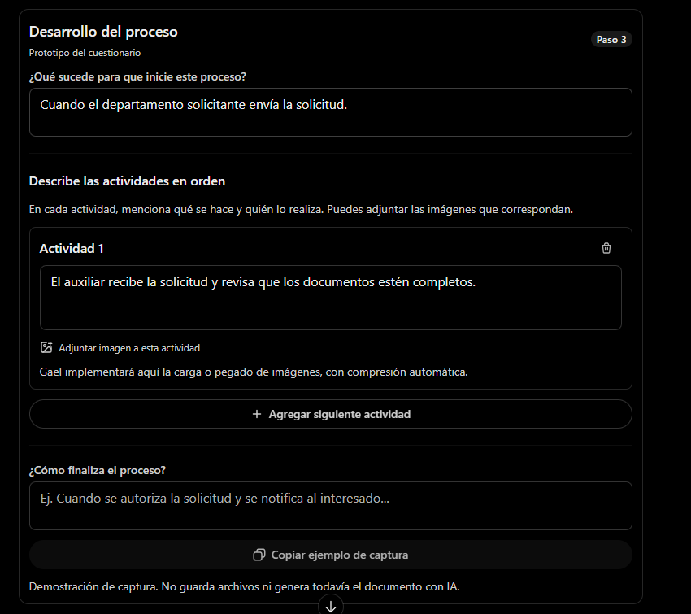

# Sistema de Documentación de Procesos — Requerimientos (transcripción)

> Transcripción fiel de `requerimientos-sistema.docx`, proporcionado por el área de Procesos.
> El original manda: si algo difiere, vale el `.docx`. Se transcribió para poder consultarlo y
> citarlo sin abrir Word. La imagen del Anexo A está en `referencia-pantalla-desarrollo.png`.

## 1. Usuarios y perfiles

| Perfil | Funciones principales |
|---|---|
| Colaborador | Crear o actualizar documentos; responder el cuestionario; adjuntar imágenes; guardar borradores; confirmar la propuesta de IA; enviar a revisión y atender observaciones. |
| Revisor de Procesos | Revisar estructura y redacción; validar contenido documental; registrar observaciones; devolver para corrección o remitir para autorización. |
| Autorizador | Consultar documentos asignados, emitir observaciones y otorgar Vo.Bo. o devolver para corrección. |
| Administrador | Administrar usuarios, perfiles y permisos; configurar catálogos, plantillas, reglas documentales y parámetros del sistema. |

**Regla de permisos:** una persona podrá tener más de un perfil si está autorizada. Ser administrador
no concede automáticamente facultades para revisar o autorizar documentos.

## 2. Información general

El colaborador capturará solo los datos indispensables; los demás se obtendrán del perfil y de los
catálogos institucionales.

| Campo | Tipo / captura | Regla |
|---|---|---|
| Tipo de solicitud | Lista / usuario | Nuevo documento o actualización de documento existente. |
| Tipo de documento | Lista / usuario | Manual, Procedimiento, Protocolo, Política. |
| Nombre del documento | Texto / usuario | Obligatorio para documentos nuevos; detectar coincidencias. |
| Documento a actualizar | Buscador / usuario | Solo al elegir actualización; buscar por nombre o código y seleccionar resultado. |
| Departamento | Catálogo / automático | Tomar del perfil; si tiene varios departamentos autorizados, permitir seleccionar. |
| Elaborador y puesto | Perfil / automático | Nombre y puesto del usuario que inicia el documento. |
| Fecha de elaboración | Fecha / automática | Fecha de creación registrada por el sistema. |
| Código documental | Alfanumérico / controlado | Pendiente de asignación o confirmado por Procesos; no duplicar. |
| Versión oficial | Alfanumérico / automático | Pendiente hasta validación/autorización según regla institucional. |

### 2.1 Creación, duplicados y actualizaciones

- Cada solicitud tendrá un identificador interno, incluso cuando no se le asigne código oficial.
- Para un documento nuevo, el sistema sugerirá coincidencias por nombre y Procesos determinará si
  procede, ya existe o no aplica.
- Para una actualización, el sistema recuperará el documento seleccionado y sus datos vigentes;
  deberá permitir trabajar sobre su contenido estructurado, cuando esté disponible.
- La actualización conservará el código original y la versión vigente no se sustituirá hasta la
  autorización/publicación.
- Procesos podrá cerrar una solicitud como no procedente, con motivo registrado y sin consumir un
  código oficial.

## 3. Desarrollo del proceso

El formulario se presentará por actividades individuales y conservará el diseño de referencia
incluido al final. Cada actividad podrá tener texto e imágenes asociadas, y el sistema evitará pedir
dos veces información que ya se proporcionó.

### 3.1 Preguntas orientadoras

1. ¿Qué sucede para que inicie este proceso?
2. ¿Qué se hace primero?
3. ¿Qué sucede después?
4. ¿Qué puesto realiza esta actividad?
5. ¿Qué ocurre si la información es incorrecta o incompleta?
6. ¿Cómo finaliza el proceso?

Las preguntas 4 y 5 se mostrarán cuando la información no esté clara o exista una validación
pertinente; las demás servirán para guiar el orden de captura sin convertirse en un cuestionario
rígido.

### 3.2 Captura de actividades e imágenes

- Cada actividad tendrá número automático, descripción libre y controles para agregar, editar,
  eliminar y reorganizar actividades.
- Podrán adjuntarse varias imágenes por actividad y pegarse capturas con Ctrl + V. La relación
  imagen–actividad se conservará al reordenar.
- Admitir PNG, JPG/JPEG y WebP. Optimizar automáticamente para reducir el peso, utilizando WebP
  preferentemente en almacenamiento; adaptar el formato para Word/PDF.
- Parámetros orientativos: calidad 80–85 %, ancho máximo cercano a 1600 px y objetivo de
  100–300 KB cuando sea posible; priorizar la legibilidad de capturas con texto pequeño.
- Permitir previsualizar, sustituir y eliminar imágenes. La IA podrá sugerir pies de imagen, sin
  cambiar su ubicación sin confirmación.

### 3.3 Análisis con IA y preguntas complementarias

La IA deberá proponer una redacción clara y ordenada, identificar responsables desde cada actividad
y generar objetivo, alcance y apartado de responsabilidades. Las definiciones serán opcionales y
podrán sugerirse a partir del contenido.

Deberá detectar, cuando sean aplicables, entradas, documentos, sistemas, validaciones,
autorizaciones, plazos, evidencias, excepciones y cierre. Si falta información indispensable,
formulará preguntas específicas (por ejemplo: «¿Quién autoriza?», «¿Qué ocurre si se rechaza?» o
«¿Qué documento se genera?»). Permitirá responder «No aplica» o «No lo sé» cuando corresponda.

La IA nunca inventará responsables, actividades, decisiones, tiempos o requisitos. Los puestos
inferidos se cotejarán con el catálogo institucional y se solicitará confirmación si resultan
ambiguos.

### 3.4 Regla de secuencia y confirmación

La IA NO podrá modificar por sí sola el orden de actividades definido por el colaborador. Solo podrá
proponer ajustes explicando cuáles y por qué; la persona decidirá si los acepta. En cualquier cambio
se preservará el vínculo de cada actividad con sus imágenes y responsables.

Antes de enviar a Procesos se mostrará una vista previa con actividades, responsables, imágenes y
textos derivados. El colaborador responderá: «¿El documento describe correctamente cómo se realiza
el proceso en tu departamento?». Si indica que requiere ajustes, podrá editar y volver a confirmar.
La confirmación quedará asociada al contenido confirmado.

### 3.5 Borrador previo y confirmación del colaborador

Al finalizar el cuestionario y el análisis de IA, el sistema mostrará un borrador integral en
pantalla, antes de generar el archivo Word o PDF. Incluirá objetivo, alcance, responsables,
actividades e imágenes asociadas. El colaborador deberá confirmar expresamente que refleja la
operación real o señalar los apartados que necesiten corrección.

Si el colaborador solicita ajustes, el sistema habilitará la edición de las respuestas o
actividades afectadas y actualizará las propuestas generadas por IA. Cada modificación posterior
invalidará la confirmación anterior, por lo que se requerirá una nueva confirmación para continuar.

Solo después de la confirmación se permitirá generar el archivo preliminar y enviarlo a revisión de
Procesos. La confirmación no equivale al Vo.Bo. institucional.

## 4. Control documental automático

### 4.1 Elaboró, revisó y autorizó

| Dato | Origen | Registro |
|---|---|---|
| Elaboró | Usuario creador: nombre y puesto | Al crear el documento |
| Revisó | Usuario con perfil revisor que concluye revisión | Al validar la revisión |
| Autorizó | Usuario autorizado que otorga Vo.Bo. | Al autorizar |
| Fechas | Fecha/hora del sistema | En cada acción correspondiente |

Los campos pendientes quedarán vacíos hasta que ocurra la acción. Los datos registrados permanecerán
ligados a la versión autorizada, aun cuando posteriormente cambie el puesto de la persona.

### 4.2 Control de cambios (solo actualizaciones)

Este apartado no se presentará para documentos nuevos. Al actualizar, el sistema sugerirá motivos
mediante comparación y el colaborador o Procesos los confirmará:

- Actualización por cambio de responsable.
- Se agregaron actividades.
- Se eliminaron actividades.
- Actualización completa del proceso (excluyente de las anteriores).

El historial oficial de cambios se incorporará solo tras autorizar la nueva versión, con fecha,
versión, motivo y autorizador. Las correcciones de borrador y revisión no incrementarán por sí mismas
la versión oficial.

### 4.3 Revisión, autorizaciones y trazabilidad

Flujo base: Borrador → En revisión de Procesos → Pendiente de autorización → Autorizado / Publicado,
con devolución a corrección cuando aplique. Procesos podrá registrar observaciones por apartado o
actividad; el colaborador atenderá y confirmará nuevamente el contenido modificado antes de reenviar.

El sistema conservará usuario, acción, fecha/hora y contenido o revisión afectada. Mientras se
prepara una actualización, la versión vigente permanecerá sin cambios.

### 4.4 Marca de agua y liberación del documento final

Todo archivo Word o PDF generado antes de la autorización final deberá mostrar, de forma visible, la
marca de agua «COPIA NO AUTORIZADA». Esto comprende los archivos preliminares que confirme el
colaborador y los utilizados por Procesos o por el autorizador durante la revisión.

La marca de agua únicamente se retirará cuando el jefe directo o director facultado, según el
esquema de autorizaciones correspondiente al documento, otorgue su Vo.Bo. final dentro del sistema.
El nombre, puesto, fecha y hora de quien autoriza se registrarán automáticamente desde su perfil y
quedarán asociados con la versión aprobada.

Tras la autorización, el sistema generará un nuevo archivo final sin marca de agua. Los archivos
preliminares conservarán la leyenda y no se reemplazarán retroactivamente; las correcciones o
rechazos mantendrán el documento en condición no autorizada. El acceso a la descarga final deberá
verificarse en el servidor, no solo en la interfaz.

## 5. Entregables y criterios de aceptación

- Crear una solicitud nueva o de actualización desde Información general, sin captura repetitiva de
  datos personales.
- Documentar actividades secuenciales, asociar imágenes y conservar las relaciones al reordenarlas.
- Generar borrador con IA sin inventar datos, mostrando aclaraciones pendientes y solicitando
  confirmación.
- Exigir confirmación del borrador en pantalla antes de generar un archivo preliminar y añadir
  «COPIA NO AUTORIZADA» a toda exportación previa al Vo.Bo. final del jefe directo o director;
  producir la versión limpia únicamente tras esa autorización.
- Permitir que Procesos revise, devuelva con observaciones y envíe a autorización.
- Registrar automáticamente elaboró, revisó, autorizó y fechas según perfiles y acciones.
- Generar control de cambios solo en actualizaciones autorizadas y conservar historial de versiones.
- Exportar documento conforme a la plantilla institucional aplicable, en Word y PDF.

## 6. Insumos y decisiones por validar

Procesos proporcionará: plantillas oficiales por tipo, ejemplos aprobados, catálogo de
puestos/departamentos, estructura de códigos, reglas de versiones, revisores/autorizadores y acceso
al inventario documental. Con Gael deberán validarse viabilidad de IA, seguridad de la información,
infraestructura, límites de imágenes y disponibilidad de contenido editable para actualizaciones.

## Anexo A. Referencia visual aprobada

Se incorpora la captura proporcionada como referencia funcional para la pantalla de Desarrollo del
proceso: pregunta inicial, actividades individuales con imágenes, botón para agregar actividad y
pregunta de finalización.

*Nota: esta imagen es una referencia de interfaz, no una funcionalidad implementada.*
